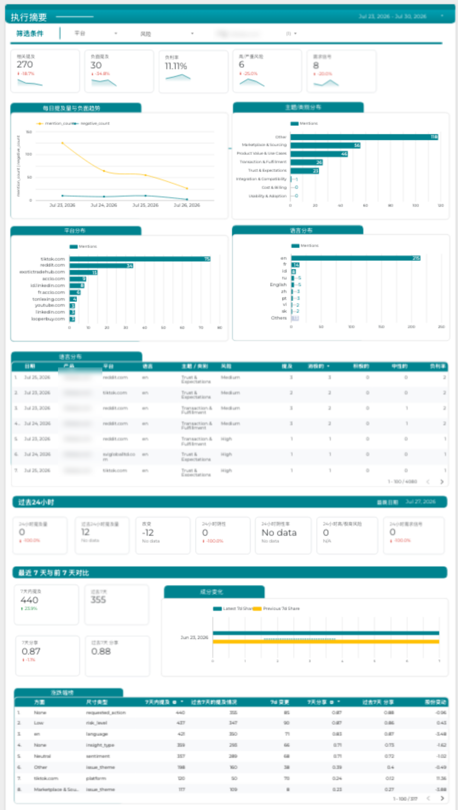
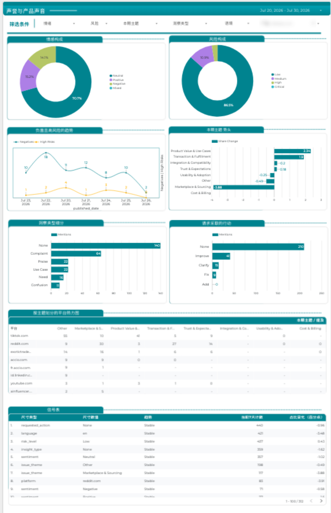
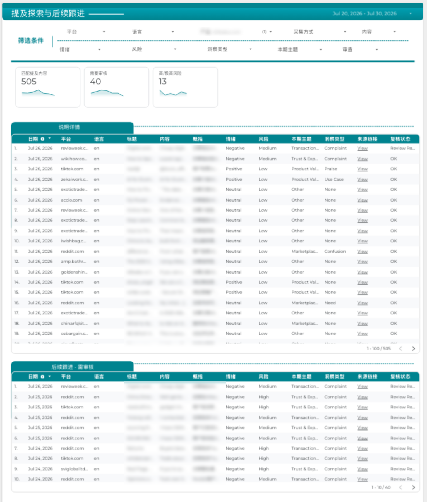

# Brand Reputation & Social Listening Dashboard (Looker Studio)

A three-page, Chinese-language monitoring dashboard that turns social and web mentions of a global B2B marketplace into a daily view of volume, sentiment, risk and product feedback, plus a working list of mentions the team needs to follow up on.

I designed and built the visualization layer: page structure, KPI logic, charts, filters, comparison modules and the follow-up workflow view.

> Client names and quoted post text are blurred in the screenshots. The report UI is in Chinese for the client's team.

## Pages

### 1. 执行摘要 · Executive Overview
The daily monitoring snapshot.

- Headline KPIs: relevant mentions, negative mentions, negative rate, high/critical risk and demand signals, each with a previous-day comparison and sparkline
- Daily mention and negative-mention trend
- Distribution by topic / category, platform and language
- Mention detail table (date, platform, language, theme, risk, mentions, sentiment counts, negative rate)
- **Latest 24 hours** module, independent of the date filter, for a same-day read
- **Last 7 days vs previous 7 days**: mentions, share, share-shift chart and a top-movers table

### 2. 声誉与产品声音 · Reputation & Product Voice
The analytical view.

- Sentiment composition and risk composition (donuts)
- Negative and high-risk trend
- Issue-theme momentum: change in each theme's share versus the previous period
- Insight-type and requested-action breakdowns, with promotional, spam and market-news content excluded so the counts reflect real product voice
- Platform-by-theme heatmap
- Signals table showing 7-day shifts across the allowed dimensions

### 3. 舆情明细 · Mention Explorer & Follow-up
The row-level working view.

- Searchable, filterable mention list with title, excerpt, Chinese summary, sentiment, risk, theme, insight type and source link
- 10 filters: platform, language, product, collection method, content, sentiment, risk, insight type, theme and review status
- KPI tiles for matched mentions, mentions needing review and high/critical risk
- Dedicated **follow-up table** of review-required mentions, sorted by risk, for the team to action

## Design decisions

- **Three audiences, three pages:** a daily snapshot for leadership, an analytical page for brand and product teams, and a row-level page for the people who respond.
- **Comparisons everywhere:** every headline number is shown against the previous day or the previous 7 days, so the question "is this getting worse?" is answered at a glance.
- **Noise removed before analysis:** promotional, spam and market-news content is excluded from insight and action breakdowns.
- **Action, not just reporting:** the follow-up table turns the dashboard into a review queue sorted by risk.

## Tools

Looker Studio · calculated fields and blended comparisons · filter controls · Chinese-language report design
